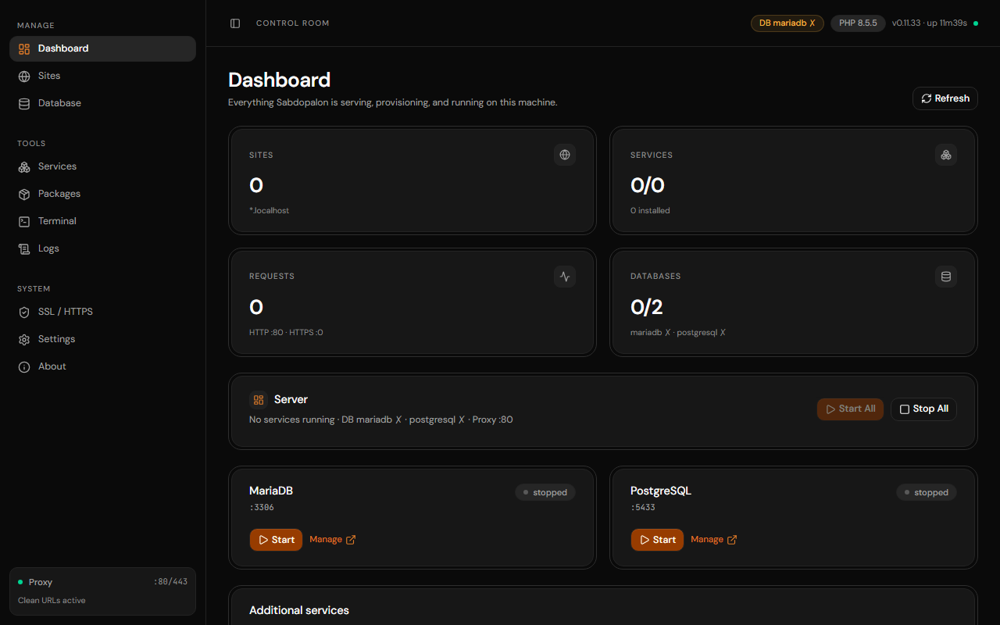
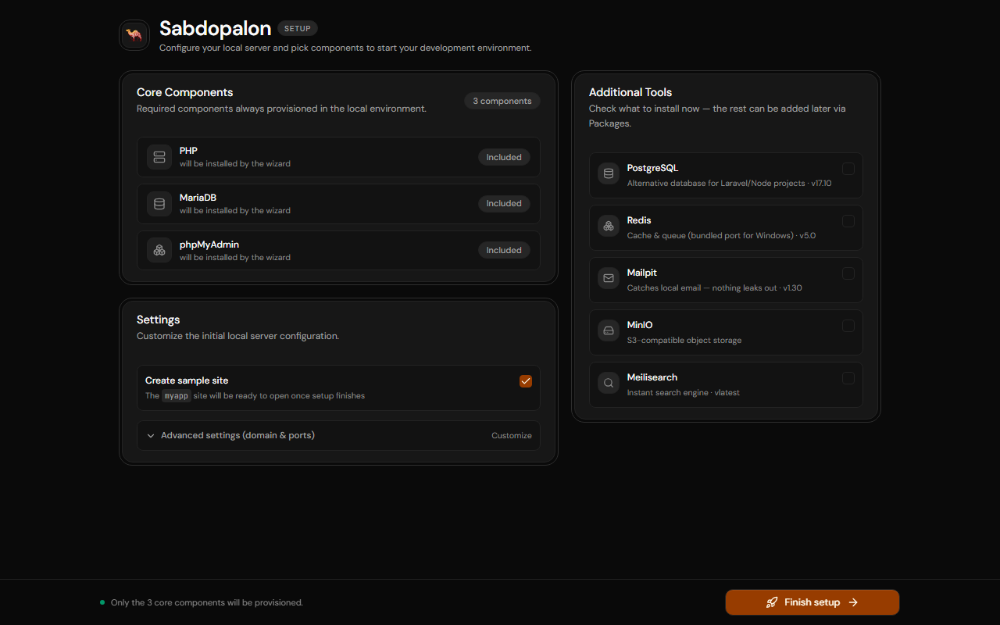
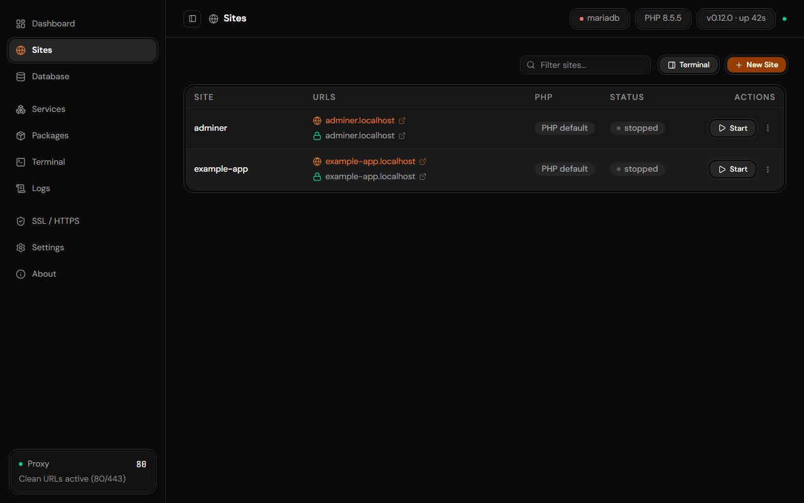
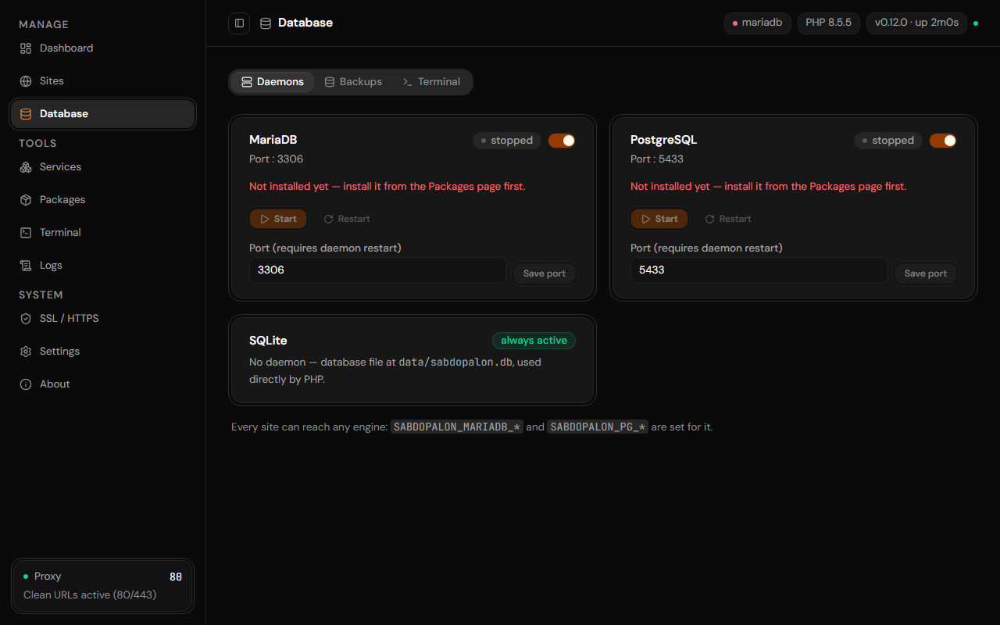
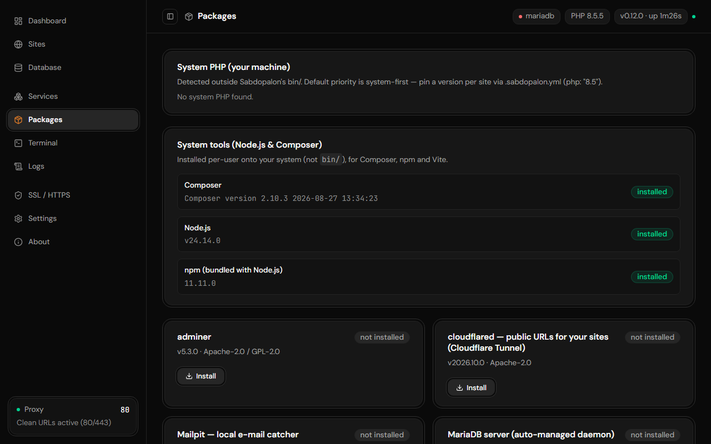
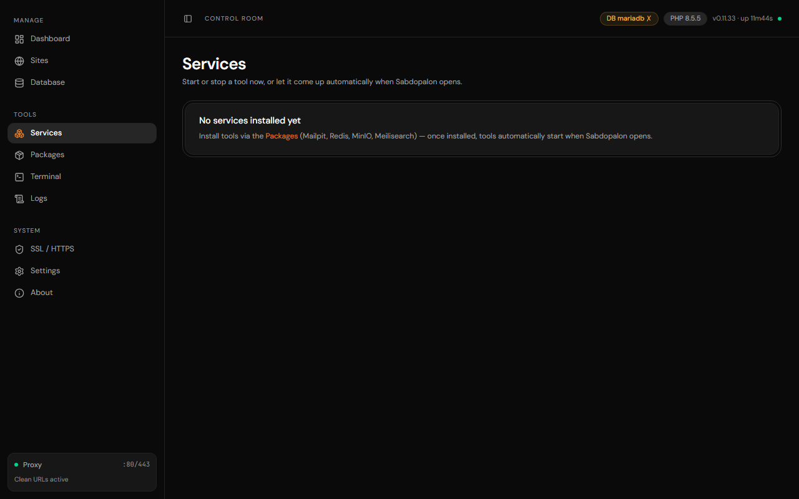
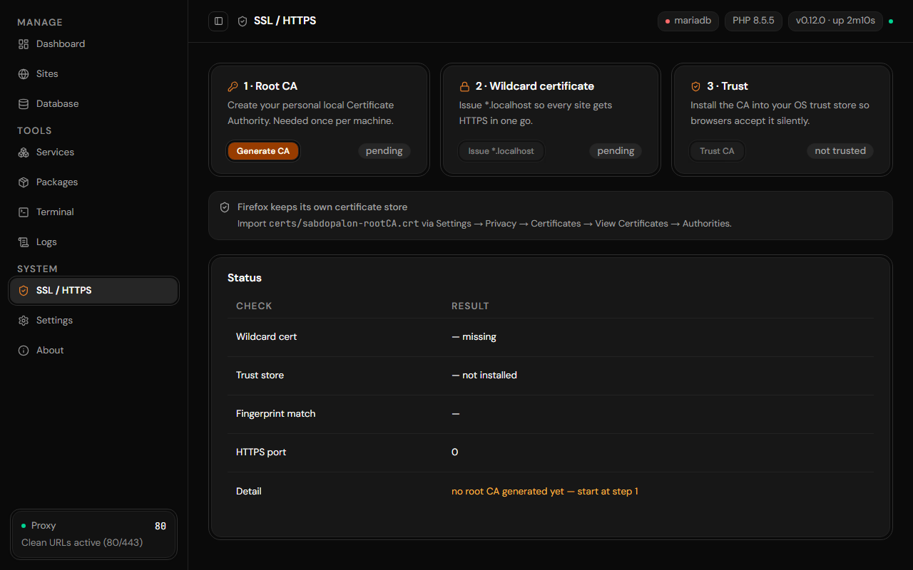
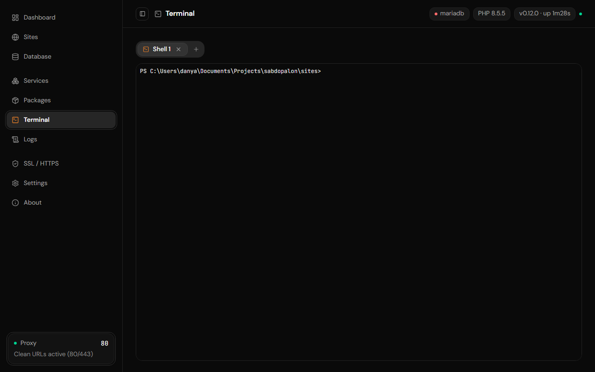
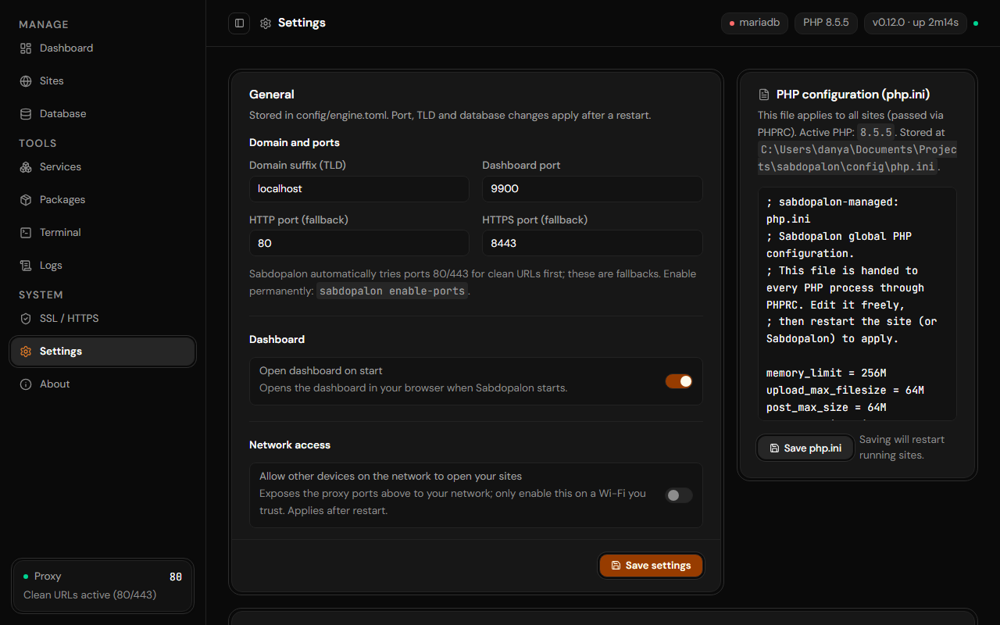
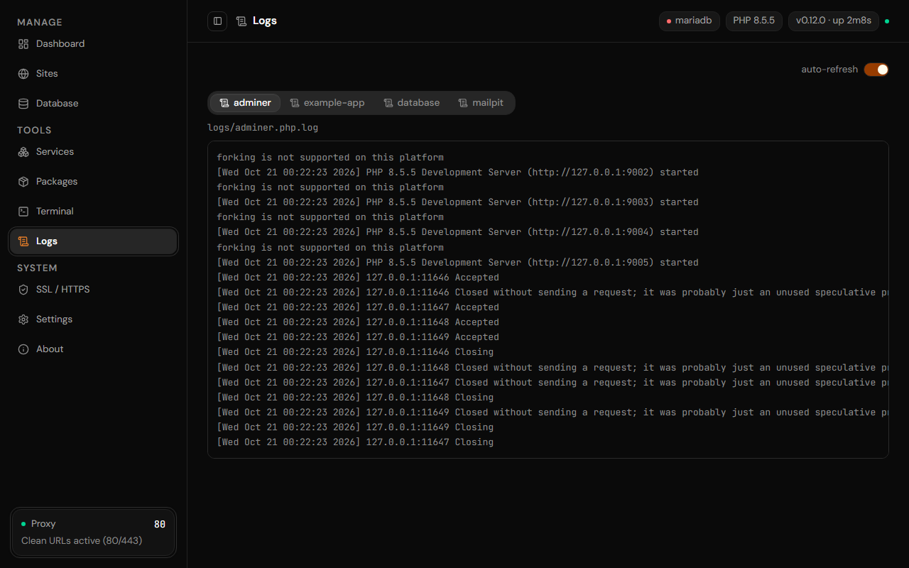

<div align="center">
  

<p><strong>A modern Laragon alternative for Windows.</strong></p>
  <p>PHP, databases, and dev tools in one folder. One installer, no setup maze.</p>

<p>
    
    
    
    
  </p>
</div>

Sabdopalon is a local PHP development environment for people who would rather
build than configure. It installs the stack, keeps every project in one folder,
and gives you a dashboard to run all of it.

If you have used Laragon on Windows, the habits carry over. A folder becomes a
site, the local database is ready to use, and a new project is one click away.
Sabdopalon keeps that workflow and rebuilds it around a modern dashboard, with
no paid tier and no Apache to configure.

No Apache or Nginx to set up. No manual PHP install. No administrator rights
for the default setup. Start it, open `http://localhost:9900`, and your sites
answer at `http://name.localhost`.

## A peek inside

<table>
  <tr>
    <td align="center">
      <a href="images/ui/dashboard.png"></a>
      <br><sub><b>Dashboard</b><br>Server status, running services, and traffic, all on one screen.</sub>
    </td>
  </tr>
</table>

<p align="center"><strong>Every page is point and click. Here is the rest of it.</strong></p>

<table>
  <tr>
    <td align="center" width="33%"><a href="images/ui/wizard-setup.png"></a><br><sub><b>Setup wizard</b><br>First run, guided</sub></td>
    <td align="center" width="33%"><a href="images/ui/sites.png"></a><br><sub><b>Sites</b><br>Create, start, stop</sub></td>
    <td align="center" width="33%"><a href="images/ui/database.png"></a><br><sub><b>Database</b><br>MariaDB, PostgreSQL, SQLite</sub></td>
  </tr>
  <tr>
    <td align="center" width="33%"><a href="images/ui/packages.png"></a><br><sub><b>Packages</b><br>PHP and tools, one click</sub></td>
    <td align="center" width="33%"><a href="images/ui/services.png"></a><br><sub><b>Services</b><br>Mailpit, Redis, MinIO</sub></td>
    <td align="center" width="33%"><a href="images/ui/ssl.png"></a><br><sub><b>SSL / HTTPS</b><br>Local certificates</sub></td>
  </tr>
  <tr>
    <td align="center" width="33%"><a href="images/ui/terminal.png"></a><br><sub><b>Terminal</b><br>Run composer, artisan, npm</sub></td>
    <td align="center" width="33%"><a href="images/ui/settings.png"></a><br><sub><b>Settings</b><br>Ports, TLD, profiles</sub></td>
    <td align="center" width="33%"><a href="images/ui/logs.png"></a><br><sub><b>Logs</b><br>Per site, per service</sub></td>
  </tr>
</table>

## Why it feels different

### Your sites are folders

Drop a project into `sites/` and it is live. No virtual host file, no restart,
no hostname to add by hand. Modern systems resolve `name.localhost` to your own
machine, so the default setup needs no Administrator prompt.

### One PHP process per site

Each site gets its own PHP process, so one project's requests do not queue
behind another's. A site can also pick its own PHP version, from 8.1 to 8.5,
and every version lives side by side in the same install.

### The stack is visible

PHP, MariaDB, PostgreSQL, SQLite, and the optional services all show up in the
dashboard. Start them, stop them, read the logs, change a port when something
else is already using it. Nothing important is buried in a config file.

### Your PATH cannot break it

Sabdopalon runs its own PHP, Composer, and Node.js by absolute path. PHP gets
its own `php.ini`, Composer gets a private home, and a global copy from another
tool cannot change how your projects behave. Your existing install stays
untouched. If you do want the system PHP, one setting in `engine.toml` switches
it.

### The dev loop is built in

The terminal opens in the site folder with the right environment. Vite,
`composer run dev`, and npm scripts start and stop per site, and hot reload
works through `name.localhost`. You can keep the editor and browser you already
use.

## What is inside

**Sites**

- Every folder in `sites/` serves at `name.localhost`
- New projects from blank PHP, Laravel, WordPress, CodeIgniter, or a Laravel
  starter kit (React, Vue, Svelte, Livewire)
- Link a project from anywhere on disk and serve it under a local name
- Per-site PHP version, document root, aliases, and environment variables
- Start, stop, restart, and share each site from its own page

**Stack**

- PHP 8.1 to 8.5, installed side by side
- SQLite out of the box, plus MariaDB and PostgreSQL
- Local HTTPS with your own certificate authority and wildcard certificate
- Custom TLDs, with the hosts file kept in sync
- One-click database backups with history
- Profiles for switching a whole stack at once

**Tools**

- Composer, pinned and run by Sabdopalon's own PHP
- Node.js and npm, one click away in Packages
- Multi-tab terminal, plus a terminal dock on every site
- Mailpit, Redis, MinIO, Meilisearch, phpMyAdmin, and Adminer
- Framework detection for Laravel, WordPress, CodeIgniter, and Symfony
- Logs for PHP, databases, mail, and dev tools

**Desktop**

- Native window for Windows, macOS, and Linux
- Tray menu, start at login, and a setup wizard on first run
- Updates from the About page, checked and verified before they run
- No telemetry, and no account to create

## Installation

There is nothing to install first. The wizard handles PHP and the database, and
Go is only needed if you build from source.

### The desktop app

The easiest path. Download the installer from the
[Releases](https://github.com/danyakmallun9999/sabdopalon/releases) page.

- **Windows:** `Sabdopalon_<version>_x64-setup.exe`
- **macOS (Apple Silicon):** `.dmg`
- **Linux:** `.deb`, `.rpm`, or `.AppImage`

Open it, answer a few questions in the setup wizard, and you are ready. The
installer includes PHP, phpMyAdmin, and Composer, and on Windows and Linux it
includes MariaDB too. On macOS, install MariaDB with Homebrew; SQLite works out
of the box, and PostgreSQL installs in one click. Node.js is a one-click install
from Packages when you need it.

### One command in the terminal

```bash
# Linux and macOS
curl -sSL https://github.com/danyakmallun9999/sabdopalon/releases/latest/download/install.sh | bash

# Windows PowerShell
irm https://github.com/danyakmallun9999/sabdopalon/releases/latest/download/install.ps1 | iex
```

The installer downloads the CLI bundle, adds it to your PATH, and starts the
setup wizard. Answer a few questions and the stack is ready.

### From source

See [CONTRIBUTING.md](CONTRIBUTING.md) for the build steps, the repo layout, and
how to run the tests.

## Quick start

The setup wizard opens on its own the first time. After that:

```bash
sabdopalon              # start the dashboard, database, and sites
sabdopalon doctor       # check PHP, ports, database, and certificates
```

Then open the dashboard at `http://localhost:9900`.

### Run a site

```bash
# From a template
sabdopalon new laravel myblog

# Or just make a folder
mkdir -p sites/myapp/public
echo '<?php echo "Hello!";' > sites/myapp/public/index.php
```

Open `http://myblog.localhost` or `http://myapp.localhost`. No restart needed.
You can do the same from the Sites page with the **New Site** button.

## How it works

Sabdopalon is one program with three jobs.

1. **It answers the browser.** A request for `myapp.localhost` is matched to
   `sites/myapp` and passed to PHP.
2. **It runs your databases.** MariaDB and PostgreSQL start when they are
   needed, listen only on loopback, and shut down with the app. SQLite is a
   file, so it needs no daemon at all.
3. **It serves the dashboard.** The React interface is embedded in the binary
   at `localhost:9900`, so there is no separate web server to run.

Apache and Nginx are not part of the stack. PHP's built-in server handles each
site, and Sabdopalon routes requests to the right one. That is why there is no
virtual host file to edit and no service to restart after adding a project.

```
Browser
   ↓
Sabdopalon (one program)
   ├─→ PHP, one process per site
   ├─→ MariaDB / PostgreSQL / SQLite
   └─→ Dashboard at localhost:9900
```

## Everyday commands

```bash
sabdopalon                 # start everything
sabdopalon doctor          # health check
sabdopalon sites           # list your sites
sabdopalon new laravel app # create a project
sabdopalon backup          # back up the database
sabdopalon share app       # temporary public URL with Cloudflare
sabdopalon hosts:sync      # update the hosts file after a TLD change
```

## Good to know

- **Local development only.** Sabdopalon is not a production server, and its
  databases listen on loopback.
- **The default domain needs no setup.** `.localhost` resolves by itself. If you
  switch to a custom TLD, your system needs one elevated `sabdopalon hosts:sync`
  to write the hosts file.
- **MariaDB on macOS is not bundled.** Use SQLite, install PostgreSQL from
  Packages, or install MariaDB with Homebrew.
- **No telemetry.** Sabdopalon itself sends none. The only outbound traffic is
  package downloads and update checks, plus the public tunnel when you start one.
- **Your data lives in one folder.** On Windows the desktop app uses
  `C:\sabdopalon` by default. Set `SABDOPALON_HOME` to put it somewhere else.
  Updates replace the program, not your sites.

## Documentation

- [Runtime and tools](docs/runtime-and-tools.md): how PHP, Composer, Node.js, and the databases are resolved
- [Custom TLDs](docs/custom-tld.md): what changes when you leave `.localhost`
- [Site creation](docs/site-creation.md): templates, starter kits, and project setup
- [Site detail and dev tools](docs/site-detail-and-devtools.md): the per-site page, Vite, and the dev-tool supervisor
- [Auto-update](docs/auto-update.md): how updates are checked, verified, and applied
- [About tab](docs/about-tab.md): identity, paths, credits, privacy, and diagnostics
- [CHANGELOG.md](CHANGELOG.md): what changed in each release
- [DESIGN.md](DESIGN.md): the architecture and the decisions behind it
- [CONTRIBUTING.md](CONTRIBUTING.md): build, test, and contribute

## License

MIT. See [LICENSE](LICENSE). Sabdopalon manages third-party open-source
components such as PHP and MariaDB, downloaded through its package system. Each
component keeps its own license.
